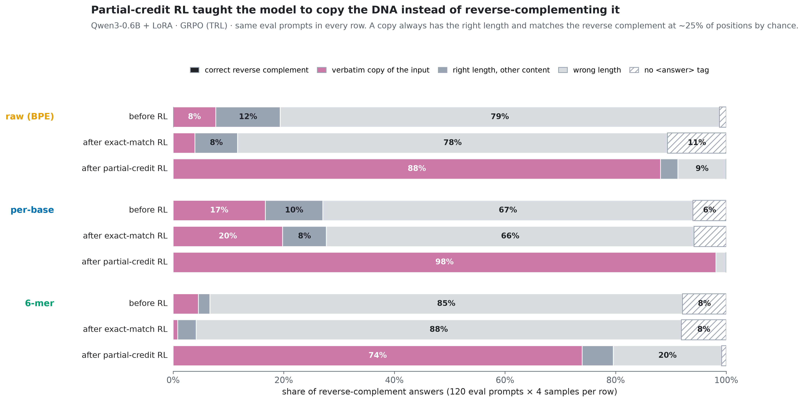

# Does RL fix what the tokenizer breaks? (DNA edition)

**TL;DR**

- **The base model can't reverse-complement DNA in any input format, so exact-match RL has nothing to amplify.** Qwen3-0.6B
  got **0 of 4,568** reverse-complement rollouts exactly right across three GRPO runs (raw BPE, per-base, 6-mer).
  Every prompt group had zero reward variance, so the policy gradient was exactly zero. Eval accuracy stayed at 0%.
- **Partial-credit reward is gamed, not learned.** With a reward of "fraction of correctly placed bases", GRPO drove
  the policy to **copy the input verbatim**: 88% of answers (raw), **98%** (per-base) and 74% (6-mer), up from 8%, 17% and 5%.
  A copy always has the right length and matches the reverse complement at ~25% of positions by chance.
  Right-length answers rose from 7–27% to 80–98%, but per-base accuracy stayed at chance (~24%).
- **The input format changed how well the model copies, not whether it can reverse-complement.** Per-base input gave the most
  faithful copies (98% right length after RL) and 6-mer input the least (80%). Errors sit at chance (~75% per base)
  whether the input base is at a token edge or inside a token. There is no boundary effect because there is no skill for
  segmentation to disrupt.

## Setup

- **Model:** `Qwen/Qwen3-0.6B`, fp32 (T4 has no bf16), LoRA r=16 / α=32 on q,k,v,o,gate,up,down; non-thinking chat
  template (`enable_thinking=False`). Prompts are passed to TRL as pre-rendered strings.
- **Tasks:** `revcomp` (return the reverse complement) and `gc_count` (number of G + C), on uniformly random DNA of length
  12–90 bp. The task family comes from FineDNA `rl_mix` (`basic_dna/reverse_complement`, `basic_dna/gc_content`). Prompts
  are generated procedurally rather than sampled, because the experiment needs identical sequences in three formats with
  balanced lengths, and reverse-complement rows are only ~0.5% of `rl_mix` (see `notes/rl_mix_schema.md`).
- **Formats** (same sequences, seed 1234):

  | format | example | Qwen3 tokens per base (eval mean) | bases at a token edge |
  |---|---|---|---|
  | `raw` | `ACGTACGATTCA` | 0.52 | 94% |
  | `perbase` | `A C G T A C …` | 1.00 | 100% |
  | `kmer6` | `ACGTAC GATTCA` | 0.55 (BPE still splits each 6-mer) | 94% |

- **Data:** 2,000 train prompts; 240 eval prompts (2 tasks × 3 length buckets × 40); 24 fixed revcomp probe prompts.
- **GRPO (TRL 1.17.1):** 8 generations × 4 prompts per step (32 completions), lr 2e-5, β = 0, temperature 1.0,
  max 192 completion tokens, 100 steps.
- **Two reward functions:**
  1. **exact match**: 1 if the last `<answer>…</answer>` equals the target after removing whitespace and uppercasing, else 0;
  2. **partial credit**: revcomp = aligned matching bases ÷ max(len(answer), len(target)); gc_count = 1/(1+|error|).
- **Eval:** 4 samples per prompt (T = 0.7, top-p 0.8). 95% bootstrap CIs (1,000 resamples over prompts). The pre-RL baseline
  is shared by both runs (same base model, same settings).
- **Compute:** Kaggle, 2× Tesla T4 per kernel, one format per GPU. Wall time:

  | run | raw | perbase | kmer6 |
  |---|---|---|---|
  | exact match | 90 steps / 30.3 min* | 90 steps / 30.6 min* | 100 steps / 16.5 min |
  | partial credit | 100 steps / 13.1 min | 100 steps / 24.7 min | 100 steps / 17.7 min |

  \* stopped by the 30-min wall-clock cap, which is logged in the kernel output.

## Results

### 1. Baseline: the format changes the answer's *shape*, not its correctness

Before RL, no format gives a single correct reverse complement (0/480 samples per format). What changes is whether the
answer has the right length: **27% (per-base) vs 19% (raw) vs 7% (6-mer)** of answers have the right length. When they do,
per-base agreement with the target is ~23–25%, which is what a random string scores. GC count is 1.5–1.7% exact in every format.
The median absolute error is ~10 on targets that average ~25.

### 2. Exact-match RL: zero signal, zero learning ([Fig 8](figures/fig8_sparse_reward_null.png))

- revcomp: **0/1,464 (raw), 0/1,464 (perbase), 0/1,640 (kmer6)** training rollouts correct, and 0 of 571 revcomp groups had
  any variance. In GRPO the advantage is reward minus the group mean, so an all-zero group gives exactly zero gradient.
  The `grad_norm` logged by TRL is 0 on most steps.
- gc_count is the only source of gradient: 33 / 43 / 28 correct rollouts. Eval GC accuracy moved from 1.5% to
  3.1% (raw), 5.4% (perbase) and 2.1% (kmer6). The CIs overlap and these are tiny effects on a 0.6B model.
- revcomp eval accuracy after RL: **0% in every format**.

### 3. Partial-credit RL: the policy discovers "copy the input" ([Fig 9](figures/fig9_what_the_answers_are.png), [Fig 2](figures/fig2_learning_curves.png))

- Training reward on revcomp rises from ~0.17–0.21 to ~0.26–0.29 (10-step means) in every format. That looks like learning.
- The eval breakdown shows what was learned. Verbatim copies of the input go **8% → 88% (raw), 17% → 98% (perbase), 5% → 74%
  (kmer6)**. No answer, before or after, is the reversal or the complement alone, let alone the reverse complement.
- Copying is a local optimum. It earns ~0.25 reward with no variance across the group, and as the policy collapses
  onto it the fraction of zero-variance groups rises (to ~0.6 for per-base by step 100). The gradient that might lead
  away from it disappears. This is classic reward hacking on a shaped reward.
- Partial-credit eval score by length ([Fig 3](figures/fig3_length_cliff.png)) converges to the ~25% copy score in every bucket
  and format. There is no length cliff because there is no skill to degrade with length.

### 4. Where errors live ([Fig 4](figures/fig4_error_positions.png))

Each output base *i* of a length-correct answer is traced back to input base *L−1−i* and labelled by where that base sits
in its input token. Error rates are **~75% everywhere**: at token edges (raw 76–77%, kmer6 75–76%, per-base 75–76%) and
inside tokens (raw 71–76%, kmer6 66–74%, with wide CIs because only ~6% of bases are interior). Position within the 6-mer
shows no consistent pattern. Length errors are what RL fixes (Fig 4C: 81% → 9% raw, 73% → 2% per-base, 93% → 20% 6-mer),
and it fixes them by copying.

### 5. Learning dynamics ([Fig 5 GIF](figures/fig5_learning.gif))

The probe grid (24 fixed prompts, greedy, every 10 steps) shows grey (wrong-length) rows turning into full-length rows
over training, with the same ~25% scatter of correct bases a copy produces.

## What this means for DNA LMs like Carbon-X

We could not test the hypothesis that segmentation caps what RL can reach. A general-purpose 0.6B model has no
reverse-complement skill in *any* input view, so the format effect has nothing to act on. Two lessons do carry over.
First, on-policy RL with verifiable rewards only amplifies behaviour the model already has: pass@8 = 0 means no learning
at all. Second, a shaped reward that gives credit for position-wise overlap is easily satisfied by copying the prompt, so
it should be paired with a check that penalises copying, or with a curriculum that starts from short sequences where
the true skill has non-zero pass@k. The one format effect we did see is that one-token-per-base input makes outputs more
length-faithful, which is consistent with Carbon-X's reported base-counting and coordinate errors. This was a vanilla
model with a *simulated* 6-mer view, not Carbon-X itself.

## Limitations

- Single seed per configuration. 90–100 GRPO steps; two runs were stopped by a 30-min wall-clock cap at step 90.
- Small model (0.6B) with LoRA rather than full fine-tuning; non-thinking mode (no chain of thought, which a
  revcomp-by-hand strategy would probably need).
- Two synthetic tasks on random DNA; prompts generated in the style of FineDNA rather than sampled from it.
- The partial-credit run was added after the exact-match run returned a null result (a post-hoc design change, approved and
  logged in `notes/progress.md`). Its pre-RL baseline is shared with the exact run.
- The 6-mer view is simulated with spaces in a BPE model. The tokenizer still splits each 6-mer into ~2–3 tokens.

## Next steps

1. **Curriculum:** start at 4–8 bp, where pass@8 > 0, and grow the length as accuracy rises. This is the cheapest way to
   give exact-match GRPO a signal.
2. **Anti-copy shaped reward:** partial credit minus a penalty for overlap with the input or its reverse.
3. **Thinking mode / scratchpad:** let the model reverse, then complement, step by step.
4. A larger model (Qwen3-4B/8B) or Carbon-X itself, where the base skill exists and the segmentation question becomes testable.

## Reproduce

See [README.md](README.md#reproduce). Kernels (private): `shamimahossain/dna-grpo-main-a`, `-main-b` (exact match),
`-dense-a`, `-dense-b` (partial credit). Versions: torch 2.11.0+cu128, transformers 5.16.1, TRL 1.17.1, PEFT (latest at run
time, with Kaggle's torchao removed), Python 3.13. Every number above is in `figures/summary.json`, and the raw eval
completions are in `results/`.
