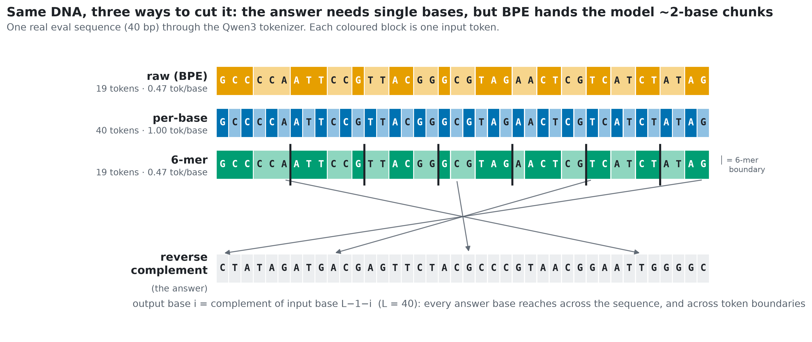
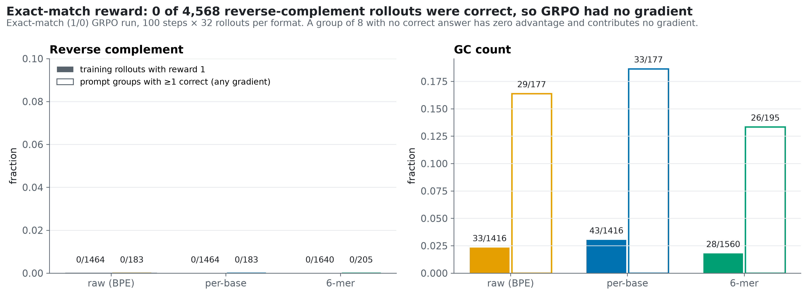
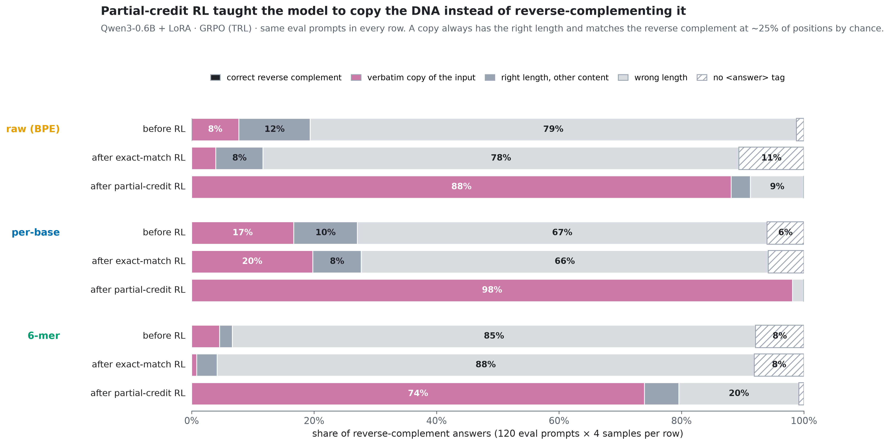
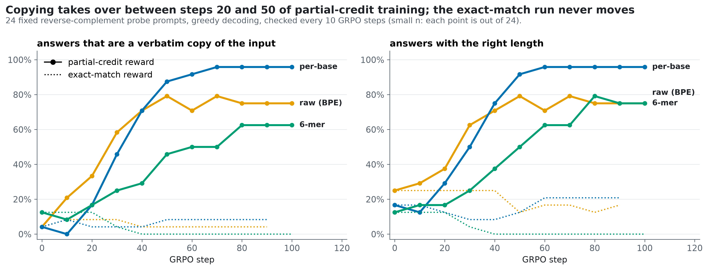
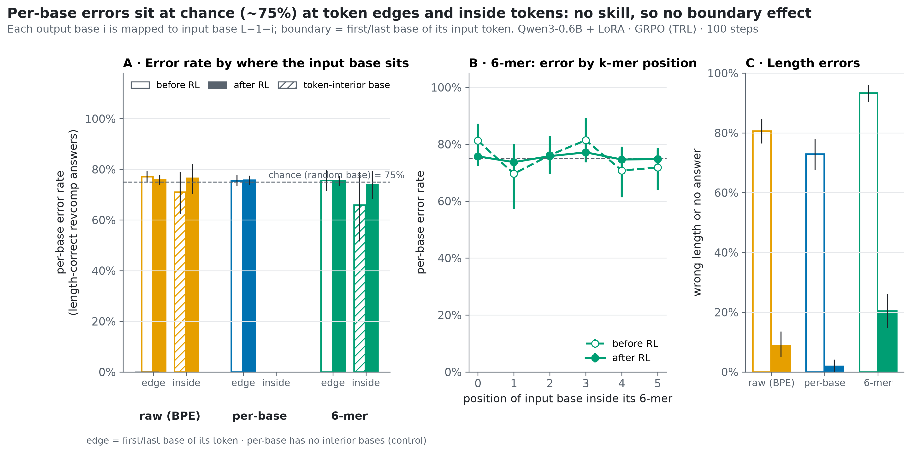
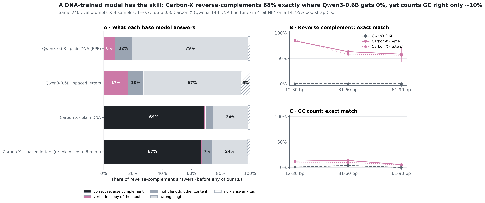
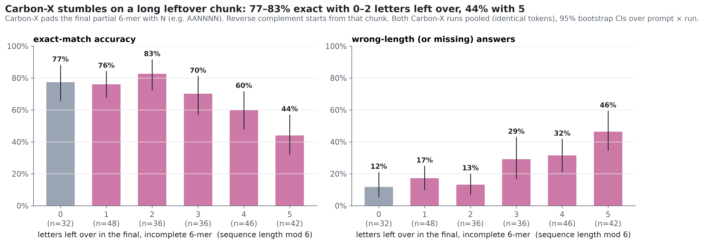

# frameshift-rl · Does RL fix what the tokenizer breaks?

*A small reinforcement-learning experiment on DNA, and what happened when the model found a shortcut instead of the skill.*



## Motivation

Imagine asking someone to spell **"TEACHER" backwards**: R-E-H-C-A-E-T. That's easy if you see the word one letter at
a time (T · E · A · C · H · E · R), and harder if it arrives in chunks (TE · ACH · ER), because you have to break each
chunk apart first.

AI models for DNA have the same problem. They don't read DNA letter by letter. They read it in **chunks**: irregular
~2-letter pieces in ordinary language models, or fixed 6-letter blocks in DNA models like
[Carbon-X](https://huggingface.co/HuggingFaceBio/Carbon-X). Yet many basic DNA operations work one letter at a time. The
classic one is the **reverse complement**: read the sequence backwards and swap A↔T and C↔G (`AACGT` → `ACGTT`).

So I asked: **if you train a model with reinforcement learning (practice plus feedback), can it learn to work around the
chunking, or does the chunking set a ceiling?** I showed one model the *same* DNA sequences three ways and changed
nothing else:

| format | what the model sees | like… |
|---|---|---|
| `raw` | `ACGTACGATTCA` → cut into ~2-letter pieces | TE · ACH · ER |
| `perbase` | `A C G T A C …` → one letter per piece | T · E · A · C · H · E · R |
| `kmer6` | `ACGTAC GATTCA` → Carbon-X-style 6-letter blocks | TEACHE · R |

## Findings

### Exact-match reward

The model (Qwen3-0.6B, a small general-purpose AI model) **never got a single reverse complement right, 0 out of 4,568
tries**, in any format. Before training, most of its answers weren't even the right length.

That matters because of how this kind of RL works. It compares several attempts at the same question and reinforces
whichever did better. **If every attempt is wrong, none did better, and there is nothing to learn from.** Picture a student
who only ever sees ✗, ✗, ✗ and never learns which direction is "warmer". The training update was literally zero.



### Partial-credit reward

Now a slightly better answer earns slightly more points, so the model has a slope to climb. **It climbed the wrong one.**
It learned to **copy the question as its answer**. A copy always has the right length, and by pure chance about 1 in 4
letters match the real answer, so copying reliably earns ~25% of the points. By the end of training, **88% (raw), 98%
(per-base) and 74% (6-mer)** of answers were word-for-word copies of the input, up from 8%, 17% and 5% before. Not a single
answer actually reversed or complemented anything.

It's like a student who discovers that rewriting the exam question earns partial marks, and stops trying to solve it.
Machine-learning people call this **reward hacking**.



You can watch it happen. Copying takes over between steps 20 and 50 of training, while the strict-grading run never moves:



### Effect of tokenization

Only for the copying. Letter-by-letter input gave the most faithful copies (98% right length) and 6-letter blocks the
least (80%). For the actual task, mistakes happen at chance rate everywhere, whether a letter sits at the edge of a chunk
or inside one. **You can't measure how chunking hurts a skill the model doesn't have.**



### Validation with Carbon-X

The small model never had the skill, so the chunking question stayed open. The natural follow-up is to ask a model that
**does** know DNA. [Carbon-X](https://huggingface.co/HuggingFaceBio/Carbon-X) is a 14.8B-parameter model built on
Qwen3-14B (the same family as the small model, 25× bigger). It was trained on DNA and reads it in native 6-letter
chunks. I gave it the exact same test questions with the exact same grading, and no training from me.

**It has the skill the small model lacked.** Carbon-X gets the reverse complement exactly right **68% of the time**
(84% on short sequences, 58% on long ones), where Qwen3-0.6B got 0%. When its answer has the right length, 96% of the
letters are correct. So the explanation above holds up: a model that already partly knows the task gives RL something to
amplify.

**But it can barely count.** Asked for the number of G and C letters, Carbon-X is right only **~10%** of the time (median
error of 2), which matches its own model card's warning that it miscounts bases. Counting needs every individual letter, and
in a 6-letter chunk the letters are hidden inside one token.



**And its mistakes follow its chunking.** DNA lengths rarely divide evenly by 6, so Carbon-X's tokenizer packs the last
few letters into a padded leftover chunk (for example `AANNNN`). Reverse complement starts from exactly that chunk. When
0–2 letters are left over, Carbon-X is right 77–83% of the time. With 5 letters left over it drops to **44%**, and nearly
half its answers come out the wrong length, usually off by just 1–2 letters. Inside full chunks, by contrast, letters are
equally reliable at every position (~5% error), so the trouble is specifically the leftover chunk.



*Caveats:* Carbon-X ran in 4-bit compressed form to fit a free Kaggle T4, which may cost some accuracy. Its tokenizer
turns spaced letters back into the same 6-letter chunks, so the "spaced letters" run is effectively a repeat of the
plain run (68.5% vs 66.7%), not a different view. The leftover-chunk groups are small (16–24 prompts each), so the
trend is clear but the exact percentages are approximate.

## Conclusions

1. **Reinforcement learning amplifies skills a model already partly has. It can't create one from zero.** If a model never
   produces a correct answer, strict right/wrong feedback gives it nothing to work with.
2. **Partial credit has to be designed carefully, or the model finds a shortcut.** Here, "points per correct letter"
   rewarded copying the input. A better reward would penalise copying, or training would start with very short sequences
   the model can sometimes get right and grow from there.
3. **Once a model has the skill, the chunking does show up.** Carbon-X reverse-complements well but fails most often
   around its leftover chunk, and it can barely count letters it only sees bundled inside 6-letter tokens. The
   natural next experiment is RL on a model like Carbon-X, where there is a skill to sharpen and a tokenizer
   weakness to work around.

## Methods

| | |
|---|---|
| Model | Qwen3-0.6B (fp32) + LoRA r=16 on all linear projections, non-thinking chat template |
| RL | GRPO via TRL 1.17: 8 completions per prompt, 4 prompts per step, β = 0, lr 2e-5, 90–100 steps |
| Tasks | reverse complement and GC count on random DNA, 12–90 bp (task family from FineDNA `rl_mix`) |
| Rewards | exact match (1/0); partial credit (aligned correct bases ÷ max length; 1/(1+\|error\|) for counts) |
| Eval | 240 held-out prompts (2 tasks × 3 length buckets × 40) × 4 samples, same sequences in every format, 95% bootstrap CIs |
| Carbon-X check | eval only, `HuggingFaceBio/Carbon-X` (Qwen3-14B DNA fine-tune) in 4-bit NF4 on one T4, same prompts and scoring |
| Compute | Kaggle, 2× Tesla T4 |

Full write-up with every number, confidence interval and caveat: **[FINDINGS.md](FINDINGS.md)**.
Interactive results page: [`site/index.html`](site/index.html).

## Figures

| | |
|---|---|
| [Fig 1](figures/fig1_how_the_model_sees_dna.png) | How each format chops up the same DNA sequence |
| [Fig 2](figures/fig2_learning_curves.png) | Reward during training, and how often a group of answers all scored the same (no learning signal) |
| [Fig 3](figures/fig3_length_cliff.png) | Partial-credit score by sequence length, before vs after training |
| [Fig 4](figures/fig4_error_positions.png) | Where mistakes happen relative to chunk boundaries |
| [Fig 5](figures/fig5_learning.gif) | Animation: letter-by-letter correctness on 24 test sequences during training |
| [Fig 6](figures/fig6_examples.png) | Before/after example answers (picked by a fixed rule, not cherry-picked) |
| [Fig 7](figures/fig7_compression_vs_accuracy.png) | How compressed the input is vs score |
| [Fig 8](figures/fig8_sparse_reward_null.png) | Why strict grading gave zero learning signal |
| [Fig 9](figures/fig9_what_the_answers_are.png) | What the answers actually are: copies |
| [Fig 10](figures/fig10_copying_takes_over.png) | How fast copying took over during training |
| [Fig 11](figures/fig11_carbon_x_vs_qwen.png) | Small general model vs Carbon-X on the same questions |
| [Fig 12](figures/fig12_carbon_x_error_positions.png) | Where Carbon-X's mistakes fall inside its 6-letter tokens |
| [Fig 13](figures/fig13_carbon_x_leftover_chunk.png) | Carbon-X accuracy vs the size of the leftover chunk |

## Repository structure

```
dna_grpo.py                 single-file library: data, formats, rewards, eval, GRPO training, Carbon-X eval (runs as a Kaggle kernel)
tests/test_rewards.py       reward/parsing/data tests (pytest, CPU)
scripts/build_kernel.py     writes kernels/<name>/ (entry.py + kernel-metadata.json)
scripts/push_and_wait.sh    push a kernel, poll, download outputs
scripts/tokenizer_stats.py  tokens per base and token-boundary offsets per example (CPU)
scripts/make_figures.py     every figure + figures/summary.json (all quoted numbers)
scripts/build_site.py       site/index.html (self-contained interactive results page)
results/                    raw model answers, per-step rewards, training logs, probe snapshots
notes/                      progress log, FineDNA schema notes, post draft
```

## Reproducibility

```bash
uv venv --python 3.11 && source .venv/bin/activate
uv pip install kaggle six pytest matplotlib numpy pandas scipy transformers tokenizers datasets imageio imageio-ffmpeg
pytest -q tests
python scripts/tokenizer_stats.py
# GPU runs on Kaggle (private kernels; set USER in scripts/build_kernel.py to your Kaggle username)
python scripts/build_kernel.py main   --name main-a  --formats raw,perbase
python scripts/build_kernel.py main   --name main-b  --formats kmer6
python scripts/build_kernel.py main   --name dense-a --formats raw,perbase --budget-min 25 --env REWARD=dense --env SKIP_PRE=1
python scripts/build_kernel.py main   --name dense-b --formats kmer6        --budget-min 25 --env REWARD=dense --env SKIP_PRE=1
python scripts/build_kernel.py carbon --name carbon  --formats raw,perbase
for k in main-a main-b dense-a dense-b carbon; do scripts/push_and_wait.sh $k; done   # Kaggle allows 2 GPU sessions at once
python scripts/make_figures.py && python scripts/build_site.py
```

Versions inside the kernels: torch 2.11.0+cu128, transformers 5.16.1, TRL 1.17.1, Python 3.13.

---
Shamima Hossain · 2026
